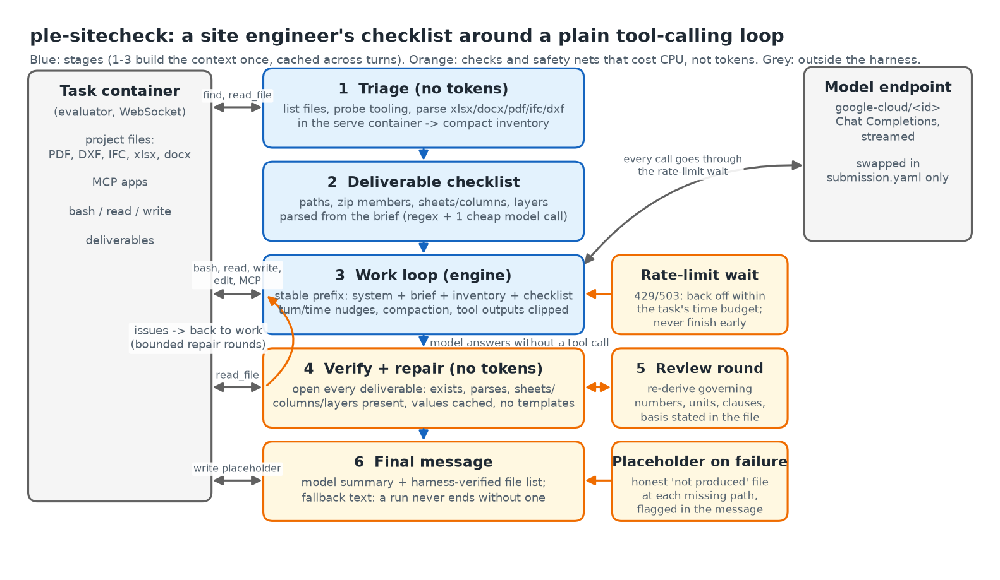

# ple-sitecheck: a site engineer's checklist around a plain tool-calling loop

Commit: `[40-char SHA from git rev-parse HEAD]` - Repository: `[GitHub URL]` - Model: `google-cloud/gemini-3.8-flash` (second model: `google-cloud/gemma-4-26b`) - Local judge: `[JUDGE_MODEL used for the committed artifacts]`

> Draft skeleton. `[...]` marks a number or figure that comes from a measured run. No task content, answers or dev-task specifics appear here; dev tasks are named only by their public task IDs. Keep under 2,000 words.

## Headline

On the 29 public dev tasks, ple-sitecheck scores `[A0 score]` with Gemini 3.8 Flash at `[$/task]`, against `[baseline score]` at `[$ baseline]` for the kit's plain loop on the same model `[cite leaderboard point]`. `[X]` of the `[Y]` points gained came from two token-free layers, a deliverable checklist with post-run verification and a file triage that parses drawings and workbooks before the first model turn, not from a stronger model. The headline failure we fixed: the model stopping with a plan or a partial file, which the plain loop accepted as the answer.

## Why a checklist, and who wrote it

I build data and AI systems: about seven years in big data and AI engineering, after postgraduate studies in Big Data and AI. I came to it from civil engineering (MSc), where I started on site supervising structural works, and this harness is where the two meet. On site, a checking engineer does not start by computing: they collect the documents, decide which revision governs, write the deliverable early, open it again and check it before signing. The failures in the public `pi-opus` trajectories (deliverable never written or at the wrong path, workbook without the asked sheet, a plan presented as a result, numbers that trace to nothing) are the mistakes a new graduate makes, and the office fixes them with procedure, not talent. ple-sitecheck is that procedure, written as code around the kit's `custom-openai` sample so any sponsored model drops in through one line of `submission.yaml`.

## Architecture (Figure 1)

Six stages per task; three cost CPU, not tokens:

1. **Triage** (no tokens): one `find`, one tooling probe, then the interesting files are read over the protocol and parsed in the serve container (openpyxl, python-docx, PyMuPDF, ifcopenshell, ezdxf). The model gets sheet names and headers, PDF outlines and first-page text, DXF layers and text entities, IFC entity counts, in about `[N]`k tokens instead of discovering them over twenty tool calls.
2. **Checklist**: deliverable paths, zip members, sheet/column names and layers parsed from the brief by regex (`[27/33]` file deliverables on the dev set), refined by one cheap model call.
3. **Work loop**: the kit's streaming loop with a stable prefix (system, brief, inventory, checklist) so prefix caching hits every turn; nudges at a fixed turn to have a first complete version on disk and under 25 minutes left to wrap up.
4. **Verify and repair** (no tokens): when the model answers without a tool call, every deliverable is opened and checked: exists, non-empty, parses, has the named sheets/columns/layers, no formula cells without cached values (a grader reading with `data_only=True` sees `None`), no template placeholders. Problems go back as a to-do list for bounded repair rounds; a tool-free "plan" while files are missing is not accepted as a finish.
5. **Review round**: one prompted self-check: re-derive the three to five governing numbers, units, the clause each came from, and state the basis inside the deliverable.
6. **Final message**: the model's structured summary plus the harness's list of files it opened and parsed; a fallback text is always set.

Two safety nets sit outside the stages: rate limits and outages are waited out within the task's time budget (a failed call costs nothing; an unfinished task scores 0), and if the loop still ends without a file, an honest placeholder saying "not produced" is written at the missing path and flagged in the final message, so a failed task leaves a traceable record rather than silence.

## 1. Insight and failure analysis

**Real failures.** `[Table: 6-10 dev-task failures observed in our runs, one line each, by type: misread callout / wrong clause or superseded revision / unit or magnitude error / stopped early / wrong path or format / tooling detour. Each row: task ID, what happened, which layer caught it (or did not).]`

Three failures were ours, not the model's, and each turned a score of 0 into `[score]`:

- *Plan accepted as done.* Gemma 4 26B answered twice with a plan and `<thought>` blocks and no tool call; the loop took the second as the final answer. Fix: a tool-free answer while required files are missing gets a bounded "carry it out with your tools" nudge, and verification runs before any `done`. `[A/B on the affected tasks]`
- *Raw bytes to the model.* `read_file` returned PDF bytes; the model spent `[N]` turns on it. Fix: documents come back as extracted text, pages and TSV rows.
- *Rate limit ended the run.* On a per-minute token quota, every call got HTTP 429, the retry schedule ran out after five attempts, and the harness sent `done` with no files. Fix: back off for as long as the task has time, honour `Retry-After`, and trim the opening context to a token budget (`[13.5k -> N]`k tokens by capping the inventory, not by dropping file types).

**Controlled ablations** (subset S6, six tasks covering every deliverable type and grader; then the full set):

| Config | What changes | Dev score | $/task | Delta |
|---|---|---|---|---|
| A0 full harness | - | `[ ]` | `[ ]` | - |
| A1 no verify loop, no review | `ENG_REVIEW=0 MAX_REPAIRS=0` | `[ ]` | `[ ]` | `[ ]` |
| A2 no triage, no checklist call | `TRIAGE=0 CHECKLIST_LLM=0` | `[ ]` | `[ ]` | `[ ]` |
| A3 medium reasoning | `REASONING_EFFORT=medium` | `[ ]` | `[ ]` | `[ ]` |

**Ideas that failed.** `[e.g. a separate planner/worker/verifier conversation (plan-verify sample) re-read the brief three times for no gain; summarising library/standards folders in full cost tokens and was never cited; ...: fill from runs]`

## 2. Engineering reasoning: one task against a licensed engineer's workflow

`[Pick one dev task, described at the level of its public task page (ple-bench.com/tasks), no quoted brief text, no answer values.]`

What a checking engineer does, in order: (a) collect the governing documents and decide which revision governs; (b) find the load path or the design basis, with the clause that fixes each input; (c) compute in a traceable sheet, units carried; (d) check magnitudes against experience and the project's own stated values; (e) write the deliverable in the asked format and state the basis; (f) open it again before signing.

Where the agent's trajectory held up: `[steps]`. Where it took shortcuts: `[e.g. read the sheet title, not the callouts; took a value from a superseded revision until the review round asked for the clause; computed by prose instead of code until nudged]`. Which skill separated pass from fail: `[reading DXF text entities / checking a code table / running the solver / writing cached values]`. `[One short excerpt of the trajectory, paraphrased, plus the grader's finding.]`

## 3. Cross-model generalisability

| Model | Dev score | $/task | Turns/task | Notes |
|---|---|---|---|---|
| gemini-3.8-flash (submitted) | `[ ]` | `[ ]` | `[ ]` | |
| gemma-4-26b | `[ ]` | `[ ]` | `[ ]` | `COMPACT_AT_TOKENS=90000`, thought tags stripped |
| gemini-4-argon `[if budget]` | `[ ]` | `[ ]` | `[ ]` | |

Changes that helped every model: `[checklist + verify; extracted-text reads; continue nudge]`. Changes that helped one model only: `[e.g. thought-tag stripping and the plan nudge mattered for Gemma; the review round paid off only on Flash]`. How model choice shifts accuracy and cost: `[two sentences with numbers]`.

## 4. Efficiency and scaling (Figure 2)

`[Plot: dev score against $/task (and tokens/task) for A0-A3, both models, and the kit leaderboard points for the sample harnesses. Mark the plateau: score vs MAX_TURNS at 40/80/160 on S6; estimate the remaining headroom from the failure breakdown: which failure types more compute would not fix.]`

Where the money goes: `[% of tokens in the cached prefix, in tool outputs, in review rounds]`. Verification and triage cost CPU only; the review round costs `[N]`% of tokens and buys `[delta]`.

## 5. Failure breakdown on the 29 dev tasks (Figure 3)

`[Stacked bar per discipline or per grader type: full credit / partial / zero, with the zero and partial cases classified: misread document, wrong clause, unit or magnitude, stopped early, wrong path or format, harness or endpoint failure. Count what the verify layer caught before grading vs what reached the grader.]`

## Reproduction and disclosure

`tests/run_smoke.sh` runs the harness end to end against a scripted mock model (no key, no Docker): normal, planner, cancel, budget, rate-limit, dead-endpoint and retry-budget scenarios. Dev artifacts were produced by `uv run python eval/run.py` with `[judge]` as the local judge `[state if not Claude Opus 5.5]`; the organisers re-score with the official judge. The harness carries no task-specific content: the checklist is regex over generic brief phrasing, the verification rules are format rules, and the engineering guidance in the prompts is method (governing documents, units, magnitudes, basis), not values.

Limitations: `[rubric tasks whose deliverable is a folder can only be checked for new files; IFC/DXF geometry is counted, not checked for clashes; one review round only; ...]`.
